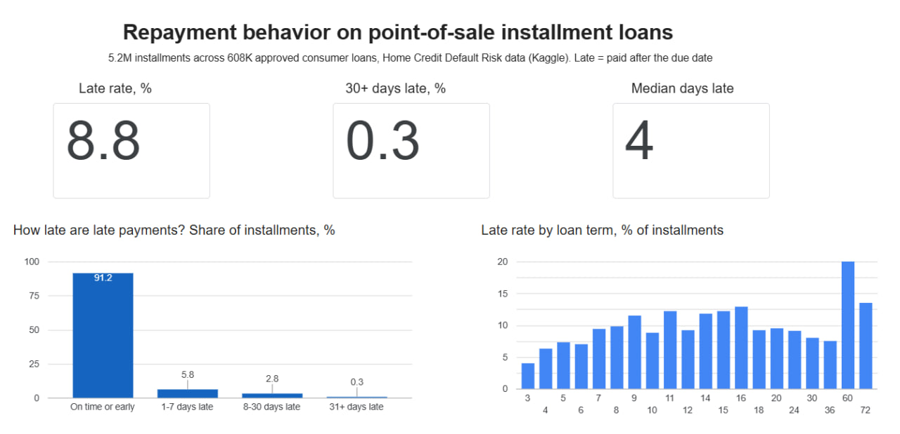
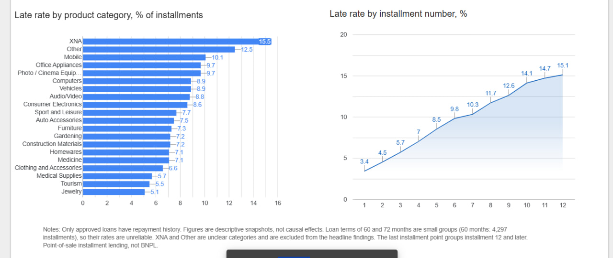

# Repayment behavior on point-of-sale installment loans

Which loan terms, product categories and installment stages are linked to late repayment, and what would a product or risk team change in reminders or approvals?

**Data:** Home Credit Default Risk (Kaggle) — `previous_application.csv` and `installments_payments.csv`
**Tools:** DuckDB (SQL), Python (pandas, matplotlib), Jupyter, Looker Studio
**Analysis set:** 5,247,484 installments across 607,983 approved consumer loans

[**View the live dashboard**](https://datastudio.google.com/reporting/34a461da-e811-4b1b-9c75-2c6d505434db/page/cx8CG) · [PDF version](docs/dashboard.pdf)




---

## Summary

Late payment on these loans is common but usually mild: 8.8% of installments are paid late, the median late payment is 4 days, and only 0.3% go past 30 days.

The strongest pattern is not who the borrower is or how long the loan runs, but **where in the loan the payment falls**. The late rate rises from 3.4% at the first installment to 15.1% at the twelfth or later, and the same rise appears within 12-month loans alone (3.3% to 18.4%), so it is not an artifact of mixing loan lengths.

Loan term carries little signal — the large term groups all sit between 7.0% and 9.2%. Product category varies moderately, from 10.1% for Mobile down to 5.1% for Jewelry.
---

## Who this helps

**Collections or CRM** — deciding when to contact a borrower. Most late payers are only a few days late, so the lever is a reminder *before* the due date, not a chase after it.

**Risk or portfolio** — deciding what to monitor. The late rate roughly quadruples between a loan's first and twelfth installment, so monitoring should be keyed to loan stage rather than to a portfolio average.

**Credit policy** — deciding what belongs in approval rules. Loan term carries almost no signal and category only a little. A useful negative result: it stops a team building rules on variables that will not hold.

The data is Home Credit's anonymized Kaggle release, covering point-of-sale installment loans — goods bought in a shop and repaid in fixed monthly installments.

---

## Can this run on another lender's data?

**Yes.** Any lender with an installment book can run this on their own portfolio.

The pipeline reads six fields: loan ID, term, product category, installment number, due date, payment date. Every metric derives from those, with no assumption about country, currency, ticket size or product mix. To adapt it, change the six column names in `sql/01_views.sql` and run the notebook.

The code transfers; the numbers do not. An 8.8% late rate is a fact about this portfolio, not a benchmark.
---

## Definitions

| Term | Definition |
|---|---|
| Late | An installment paid after its due date |
| Days late | Actual payment date minus due date, counted only for late installments |
| Late rate | Late installments as a share of all installments in a group |
| Analysis set | Installments on approved consumer loans, after cleaning |
| Installment number | The position of a payment within its loan; capped at 12 for charting, where 12 means "12 or later" |

---

## Findings

Full write-up with caveats: [`summary/findings.md`](summary/findings.md)

**1. Late payment is common but usually brief.** 8.8% of installments are late, the median late payment is 4 days, and only 0.3% go past 30 days. *Recommendation:* send reminders one to two days before the due date rather than chasing payments afterwards.

**2. Lateness rises steadily through the life of a loan.** The late rate climbs from 3.4% at the first installment to 15.1% at the twelfth or later, and holds within 12-month loans alone (3.3% to 18.4%). *Recommendation:* keep the reminder schedule constant, but monitor later installments more closely in risk reporting.

**3. Loan term carries little signal.** The large term groups sit between 7.0% and 9.2%. The highest rates come from very small groups, such as 60 months at 20.0% on only 4,297 installments. *Recommendation:* do not use loan term as a standalone signal in approval rules.

**4. Product category varies moderately.** Among clear categories, Mobile is highest at 10.1% and Jewelry lowest at 5.1%. XNA (15.5%) and Other (12.5%) are unclear categories and are excluded from the headline findings. *Recommendation:* neither loan term nor product category should be used alone, because both probably proxy for borrower mix rather than causing lateness.

---

## Method

1. **Load.** Both CSVs loaded into a local DuckDB database.
2. **Quality checks.** Row counts, null rates, duplicate keys and date ranges checked before analysis.
3. **Build tables.** `apps`, `approved_loans`, `inst_clean` and `installments` created as views and tables (see `sql/01_views.sql`).
4. **Clean.** 10,653 installment rows numbered beyond their loan's stated term were removed as a data quality issue.
5. **Compute metrics.** Late rate, lateness buckets, and breakdowns by term, category and installment number (see `sql/02_metrics.sql`).
6. **Export.** Summary tables written to `summary/` as CSVs; charts written to `docs/`.
7. **Dashboard.** The five summary CSVs uploaded to Looker Studio as the dashboard's data sources.

---

## Repository structure

```
sql/                     SQL for views and metrics
  01_views.sql
  02_metrics.sql
notebooks/
  analysis.ipynb         Full analysis, from load to export
summary/                 Summary tables as CSVs, plus the findings write-up
  findings.md
  kpis.csv
  lateness_buckets.csv
  late_by_term.csv
  late_by_category.csv
  late_by_installment_no.csv
  late_by_installment_no_12m.csv
docs/                    Charts, dashboard exports and working notes
  notes.md
  dashboard_top.png
  dashboard_bottom.png
  dashboard.pdf
  q1_lateness_distribution.png
  q2_late_by_term.png
  q3_late_by_category.png
  q4_late_by_installment_no.png
README.md
.gitignore
```

The raw data, the DuckDB database and the virtual environment are not tracked in this repository.

---

## How to reproduce

1. Download `previous_application.csv` and `installments_payments.csv` from the [Home Credit Default Risk competition](https://www.kaggle.com/competitions/home-credit-default-risk/data) on Kaggle and place them in a `data/` folder.
2. Create and activate a virtual environment, then install the dependencies:

```
python -m venv venv
venv\Scripts\activate
pip install duckdb pandas matplotlib jupyter
```

3. Start Jupyter and open `notebooks/analysis.ipynb`:

```
jupyter notebook
```

4. Run the notebook top to bottom. It creates the DuckDB database, builds the tables, computes the metrics and writes the CSVs and charts.

---

## Limitations

- **Approved loans only.** Only approved applications have repayment history, so rejected applicants are not represented. The late rates here describe people who were accepted, not all applicants.
- **Association, not causation.** Every result here is descriptive. The rise in lateness across a loan's life may reflect a changing mix of borrowers rather than anything about the installment itself.
- **Small groups are unstable.** Loan terms of 60 and 72 months have few installments (60 months: 4,297), so their high late rates should not drive decisions.
- **Unclear categories.** XNA and Other are not meaningful product categories and are excluded from the headline findings, though they are shown in the dashboard for completeness.
- **Not BNPL.** This is point-of-sale installment lending, which differs from buy-now-pay-later products in term length, ticket size and underwriting.
- **A historical snapshot.** The dataset is static, so the dashboard shows a snapshot rather than live data.

---

## Next steps

- Test whether the rise in lateness across a loan's life persists after controlling for borrower characteristics, which would separate a genuine stage effect from a changing borrower mix.
- Compare first-time and repeat borrowers, since repeat customers may behave differently at the same installment stage.
- Measure how much of the 8.8% late rate is concentrated in a minority of borrowers, rather than spread evenly across them.
- Examine whether payment amount relative to the original loan size is linked to lateness.

---

## Author

Jafar Bahodirov — student at Westminster International University in Tashkent, business analyst intern (ERP projects), AI intern at FlyRank AI.
